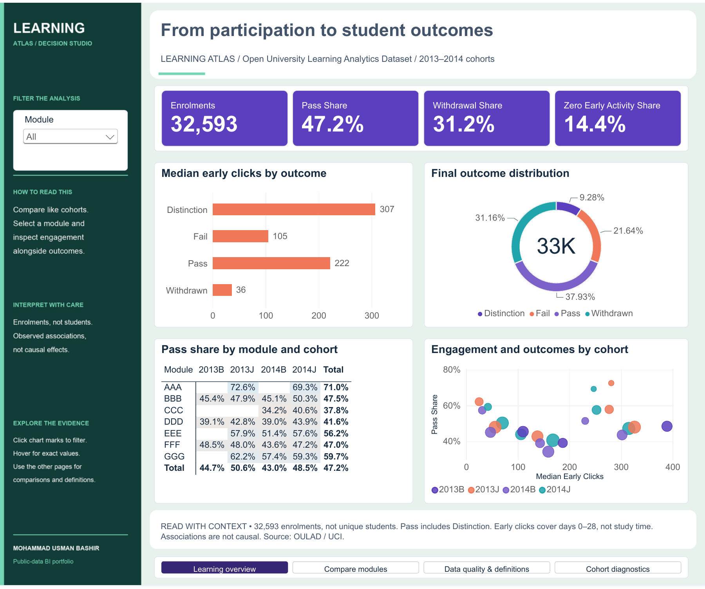

# Learning Atlas

Early activity and student outcomes by cohort. A public-data business intelligence portfolio project by Mohammad Usman Bashir.

## Business question

How do early recorded activity and eventual outcomes vary across modules and presentations?

## What I built

I built a Power BI report using the Open University Learning Analytics Dataset. I validated composite enrolment keys before joining registration, assessment and activity data. I retained zero-activity enrolments and missing assessment scores explicitly. I added a cohort heatmap and interactive scatterplot to compare participation patterns with eventual outcomes.

The report includes an overview, a comparison page, a data-quality and definitions page, and an interactive diagnostic page. The current native report is in [Learning Atlas.pbix](Learning%20Atlas.pbix). The [PDF](Learning%20Atlas.pdf) and PNGs are static previews exported from that saved report on 14 November 2026.

## Download the data and documentation

- [Prepared CSV datasets, methodology, DAX, Power Query, SQL, native report definitions and validation evidence](learning-atlas-data-and-documentation.zip). Extract the ZIP to retain its documented folder structure.
- [Complete four-report bundle and original public source snapshots](https://github.com/usman5642/powerbi-portfolio/releases/tag/atlas-v1.0.0). This includes the shared Python rebuild and verification scripts.

## Validation and scope

I checked the reported metrics independently using Python and SQL. The four-report release passed 217 metric, data, SQL and native-file integrity checks; rebuilding the prepared Fact tables from the pinned public sources also matched the released data. Interaction checks were performed in Power BI Service. Windows Desktop reopening and refresh remain untested.

This is an independent public-data portfolio project. I do not present descriptive patterns as causal effects or measured business improvements. The PBIX contains imported data; screenshots and the PDF are static previews. Read the bundled methodology for denominators and limitations.

## Sources

Source attribution and licence references are included in the bundle and in the [shared source guide](../ATLAS_SOURCES.md).
